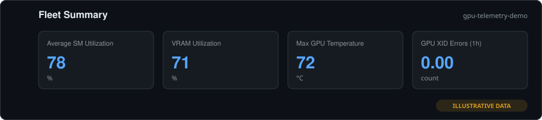
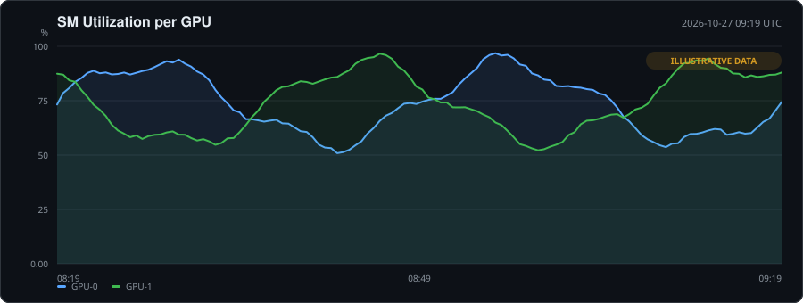
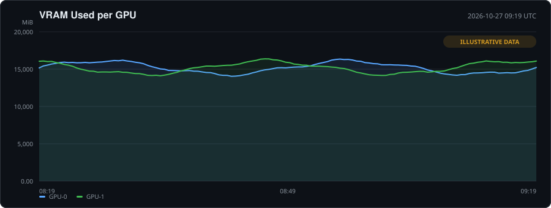
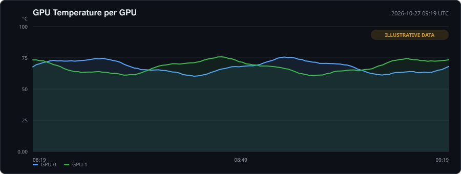
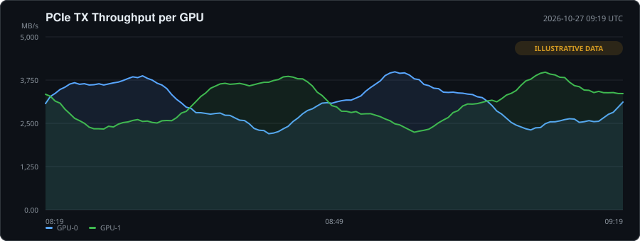
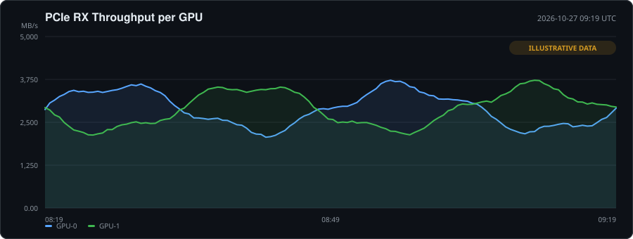
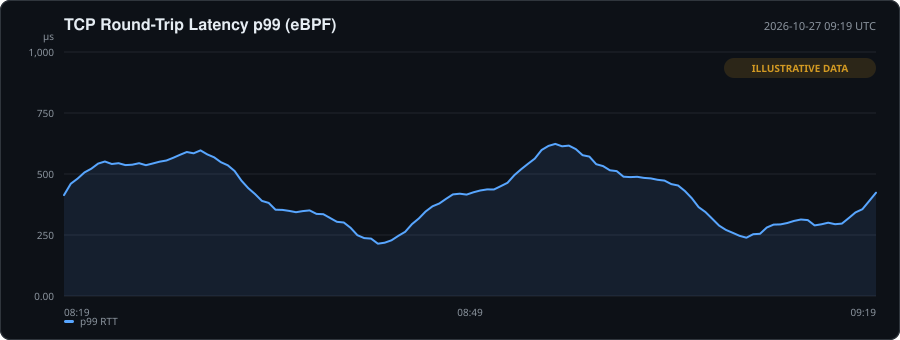
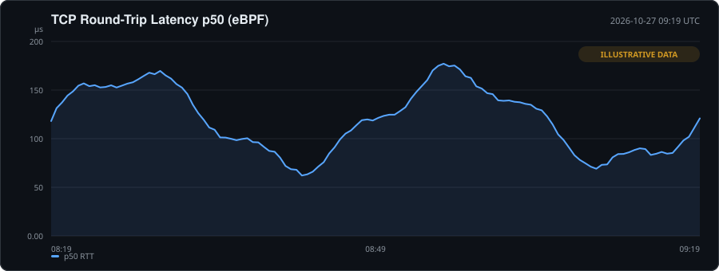

# k8s-gpu-telemetry-stack

Production-grade observability bootstrap for GPU-accelerated Kubernetes clusters.

[](LICENSE)
[](https://helm.sh)
[](https://kubernetes.io)
[](https://www.nvidia.com)
[](https://github.com/victorbecerragit/k8s-gpu-telemetry-stack/actions/workflows/lint.yaml)
[](https://github.com/victorbecerragit/k8s-gpu-telemetry-stack/actions/workflows/publish-helm-chart.yml)
[](https://victorbecerragit.github.io/k8s-gpu-telemetry-stack)

**Latest**: [v0.1.3](https://github.com/victorbecerragit/k8s-gpu-telemetry-stack/releases/tag/v0.1.3) — Pod attribution for GPU metrics via DCGM Kubernetes mode.



> **About the charts in this README.** The images are rendered from
> `demo/snapshots/example.json`, a **synthetic** snapshot generated by
> `scripts/generate-example-snapshot.py`. They are watermarked
> `ILLUSTRATIVE DATA` and are not captured telemetry. Run the
> [GKE demo](#gke-demo) to replace them with real DCGM and eBPF data.

## Install from the Helm repository

GitHub Pages **is** the Helm repository — it serves `index.yaml` and the packaged
`.tgz` files, so `helm repo add` works against it directly. No third-party
registry is involved.

```bash
helm repo add gpu-telemetry-stack https://victorbecerragit.github.io/k8s-gpu-telemetry-stack
helm repo update

# GKE — GKE manages the NVIDIA driver and device plugin
helm install gpu-telemetry gpu-telemetry-stack/gpu-telemetry-stack \
  -n gpu-telemetry --create-namespace \
  -f https://raw.githubusercontent.com/victorbecerragit/k8s-gpu-telemetry-stack/main/charts/gpu-telemetry-stack/values-gke.yaml

# EKS — the GPU Operator installs drivers
helm install gpu-telemetry gpu-telemetry-stack/gpu-telemetry-stack \
  -n gpu-telemetry --create-namespace \
  -f https://raw.githubusercontent.com/victorbecerragit/k8s-gpu-telemetry-stack/main/charts/gpu-telemetry-stack/values-eks.yaml
```

Browse the repository index at
<https://victorbecerragit.github.io/k8s-gpu-telemetry-stack>.

### Install from GHCR (OCI)

The same chart is also published as an OCI artifact, so no `helm repo add` is
needed:

```bash
helm install gpu-telemetry oci://ghcr.io/victorbecerragit/charts/gpu-telemetry-stack \
  --version 0.1.3 \
  -n gpu-telemetry --create-namespace \
  -f https://raw.githubusercontent.com/victorbecerragit/k8s-gpu-telemetry-stack/main/charts/gpu-telemetry-stack/values-gke.yaml
```

Both registries serve byte-identical packages built from the same tag.

## Included components

- Root Helm chart (`gpu-telemetry-stack`) orchestrating:
  - DCGM exporter for GPU hardware metrics (SM util, VRAM, PCIe, temp, XID)
  - eBPF probe DaemonSet for socket-level TCP latency visibility
  - Prometheus stack wrapper with GPU/network SRE alert rules
  - Grafana wrapper with a pre-built GPU telemetry dashboard
  - NVIDIA GPU Operator wrapper (EKS only — GKE manages drivers itself)

## Observability assets

### Dashboard

`GPU Telemetry — Fleet & Network` (uid `gpu-telemetry-fleet`) is shipped as a
sidecar-discovered ConfigMap and auto-provisioned into the **GPU Telemetry**
folder. Panels cover:

- Fleet overview: average SM utilization, VRAM utilization, max temperature, XID errors (1h)
- Per-GPU detail: SM utilization, VRAM used, temperature, PCIe TX/RX throughput
- Network: p99 and p50 pod-to-pod TCP round-trip latency from eBPF probes

### Alerts

Rendered as a `PrometheusRule` by the Prometheus wrapper chart:

| Alert | Severity | Trigger |
| --- | --- | --- |
| `GpuXidError` | critical | Any new `DCGM_FI_DEV_XID_ERRORS` in 5m |
| `GpuThermalThrottling` | warning | GPU temp > 85 °C for 5m |
| `GpuVramExhaustion` | warning | VRAM > 90 % for 10m |
| `GpuNotReporting` | critical | DCGM exporter scrape target down 5m |
| `GpuPodTcpLatencyHigh` | warning | p99 pod-to-pod TCP latency > 5000 µs for 10m |

Thresholds are configurable under `prometheus.rules.thresholds` in `values.yaml`.

## GKE demo

A complete, disposable demo environment lives in `terraform/` and `demo/`. It
provisions a zonal GKE cluster with a tainted GPU node pool, installs the stack,
and runs workloads that generate real GPU and network telemetry.

### What gets created

| Layer | Resources |
| --- | --- |
| `terraform/` | VPC + subnet, zonal GKE cluster (default pool removed), `e2-standard-4` system pool, `g2-standard-4` + `nvidia-l4` GPU pool (tainted, Spot by default) |
| `terraform/incluster/` | Helm release of this chart with `values-gke.yaml`, plus the demo workloads |
| `demo/` | `gpu-burn` matmul loop (SM/VRAM/PCIe/temp) and a client/server pair driving pod-to-pod TCP traffic |

### Run it

```bash
export GCP_PROJECT_ID=your-project-id

./scripts/demo-gke.sh up        # ~15-20 min: cluster + stack + workloads
./scripts/demo-gke.sh status    # nodes, telemetry pods, demo pods
./scripts/demo-gke.sh snapshot  # capture Prometheus data into demo/snapshots/
./scripts/demo-gke.sh down      # destroy everything
```

`snapshot` writes a timestamped JSON file and prints the render command:

```bash
python3 scripts/render-demo-charts.py \
  --input demo/snapshots/snapshot-<timestamp>.json \
  --output-dir docs/images
```

Reach the UIs with:

```bash
kubectl port-forward -n gpu-telemetry svc/gpu-telemetry-grafana 3000:80
kubectl port-forward -n gpu-telemetry svc/gpu-telemetry-prometheus-kube-prometheus-prometheus 9090:9090
```

### Cost and cleanup

The GPU pool uses Spot VMs by default and autoscales from one node. Set
`use_spot_instances = false` in `terraform/terraform.tfvars` if you need
guaranteed capacity. **Always run `./scripts/demo-gke.sh down`** when finished —
a GPU node left running is the main cost driver.

### GKE-specific configuration

`values-gke.yaml` differs from the EKS overlay in three ways:

1. **GPU Operator disabled.** GKE installs the NVIDIA driver and device plugin
   on GPU node pools. Running the operator too would create a second device
   plugin competing for the same devices.
2. **GPU taint tolerations.** The GPU pool is tainted
   `nvidia.com/gpu=present:NoSchedule`, so DCGM and the demo workload declare
   explicit tolerations.
3. **Node pinning.** DCGM is pinned to `workload=gpu-telemetry`; Prometheus,
   Alertmanager and Grafana are pinned to `workload=observability`.

## Visualizations

Rendered from the demo snapshot by `scripts/render-demo-charts.py` (pure
standard library — no matplotlib, no network).

### SM utilization per GPU



### VRAM used per GPU



### GPU temperature per GPU



### PCIe throughput per GPU





### Pod-to-pod TCP round-trip latency (eBPF)





## Network telemetry

The eBPF DaemonSet runs Inspektor Gadget's `profile_tcprtt` gadget, which emits
a native histogram of kernel-smoothed TCP round-trip time in microseconds.

The gadget exports Prometheus metrics through Inspektor Gadget's OTel metrics
operator:

```text
ig run profile_tcprtt \
  --otel-metrics-listen --otel-metrics-listen-address :2224 \
  --annotate "tcprtt:metrics.collect=true" \
  --otel-metrics-name "tcprtt:gadget_tcp_latency_us"
```

Three details matter and are easy to get wrong:

1. **The gadget must be `profile_tcprtt`.** `trace_tcp` reports
   connect/accept/close *events* and has no latency data.
2. **The data source is named `tcprtt`.** Both `--annotate` and
   `--otel-metrics-name` must use that name. Using the chart name instead makes
   the operator silently export nothing.
3. **The exported series is `latency_bucket`**, scoped by
   `otel_scope_name="gadget_tcp_latency_us"` — not
   `gadget_tcp_latency_us_bucket`. The dashboard and alert query the real name.

A `Service` and `ServiceMonitor` expose and scrape `:2224/metrics`.

### Is Grafana Alloy worth adding?

**Recommendation: not yet.** Alloy is a collector, not a metrics source; it
cannot manufacture latency data. With the gadget now exporting metrics natively,
the dashboard and alert have a real data source without an extra DaemonSet.

Add Alloy when at least one of these becomes true:

- You want gadget **events as logs** in Loki.
- You need **OTLP traces** from GPU workloads, not just metrics.
- You must fan out to **multiple backends**.
- You want one collector to own **scrape, relabel, and remote-write** policy.

## Project layout

```text
charts/gpu-telemetry-stack/          # root chart
  Chart.yaml                         # metadata, keywords, dependencies
  README.md                          # chart-level docs (rendered by Artifact Hub if listed)
  values.yaml                        # defaults
  values-gke.yaml                    # GKE overlay (GPU Operator off)
  values-eks.yaml                    # EKS overlay
  values-dev.yaml                    # local/dev overlay
  charts/dcgm-exporter/              # GPU hardware metrics DaemonSet
  charts/ebpf-probes/                # profile_tcprtt DaemonSet + metrics Service
  charts/prometheus/                 # kube-prometheus-stack wrapper + alerts
  charts/grafana/                    # Grafana wrapper + dashboard JSON
  charts/gpu-operator/               # NVIDIA GPU Operator wrapper
terraform/                           # GKE infra root (VPC, cluster, node pools)
terraform/incluster/                 # Helm + demo workload deployment root
demo/                                # demo workloads and captured snapshots
docs/images/                         # rendered charts used by this README
docs/pages/index.html                # landing page published to gh-pages
scripts/                             # bootstrap, lint, validation, demo tooling
tests/                               # pytest suite
.github/workflows/                   # lint/test + chart publishing
```

## Scripts

| Script | Purpose |
| --- | --- |
| `scripts/bootstrap.sh` | Add Helm repos, build dependencies, render-test |
| `scripts/lint.sh` | Lint the root chart and every local subchart |
| `scripts/validate-dcgm-metrics.sh` | Assert expected DCGM metrics are scraped |
| `scripts/validate-ebpf-probes.sh` | Assert eBPF pods are ready and tracing |
| `scripts/demo-gke.sh` | Provision / snapshot / status / destroy the GKE demo |
| `scripts/collect-demo-metrics.py` | Query Prometheus and write a snapshot JSON |
| `scripts/render-demo-charts.py` | Render snapshots to dependency-free SVG |
| `scripts/generate-example-snapshot.py` | Generate the synthetic example snapshot |

## Tests

```bash
python3 -m pytest -q
```

The suite covers chart rendering across all three overlays, dashboard/alert
consistency with the metrics the stack actually emits, Terraform formatting and
validation, demo manifest correctness, script syntax, and SVG output validity.

Notable regression guards:

- The dashboard and `GpuPodTcpLatencyHigh` must query
  `latency_bucket{otel_scope_name="gadget_tcp_latency_us"}`.
- The legacy inert `gadget_tcp_latency_us_bucket` name must not reappear.
- The eBPF gadget must be `profile_tcprtt`, not `trace_tcp`.
- GKE must not render the GPU Operator; EKS must.
- Committed charts must carry the `ILLUSTRATIVE DATA` watermark.

## Quick start (existing cluster)

1. Build dependencies and render-test manifests:

   ```bash
   ./scripts/bootstrap.sh
   ```

2. Lint all charts:

   ```bash
   ./scripts/lint.sh
   ```

3. Install on cluster:

   ```bash
   # GKE
   helm install gpu-telemetry ./charts/gpu-telemetry-stack \
     -n gpu-telemetry --create-namespace \
     -f ./charts/gpu-telemetry-stack/values.yaml \
     -f ./charts/gpu-telemetry-stack/values-gke.yaml

   # EKS
   helm install gpu-telemetry ./charts/gpu-telemetry-stack \
     -n gpu-telemetry --create-namespace \
     -f ./charts/gpu-telemetry-stack/values.yaml \
     -f ./charts/gpu-telemetry-stack/values-eks.yaml
   ```

4. Validate:

   ```bash
   ./scripts/validate-dcgm-metrics.sh
   ./scripts/validate-ebpf-probes.sh
   ```

## Releasing

The chart is published to GitHub Pages by
`.github/workflows/publish-helm-chart.yml`. To cut a release:

1. Bump `version` in `charts/gpu-telemetry-stack/Chart.yaml` (and `appVersion`
   if the bundled stack changed).
2. Update the `artifacthub.io/changes` annotation in the same file (it doubles
   as the human-readable changelog in `index.yaml`).
3. Commit, then tag with a matching `v` prefix:

   ```bash
   git tag v0.2.0
   git push origin v0.2.0
   ```

The workflow validates the tag against `Chart.yaml`, lints, renders all three
overlays, runs the test suite, packages the chart, merges the new entry into the
existing `index.yaml`, and pushes to `gh-pages`. A GitHub release is created
automatically.

You can also run it manually from the Actions tab with `dry_run` enabled to
validate without publishing.

### Enabling GitHub Pages

One-time setup after the first publish:

1. **Settings → Pages → Source: Deploy from a branch**
2. Branch: `gh-pages`, folder: `/ (root)`
3. The repository is then served at
   `https://victorbecerragit.github.io/k8s-gpu-telemetry-stack`

### Optional: listing on Artifact Hub

Artifact Hub is a **discovery site, not a registry**. It crawls an existing Helm
repository and indexes it for search; it does not host charts and does not
change how anyone installs them. `helm repo add` still points at the GitHub
Pages URL either way.

There is no need to register until the chart has been exercised a few times.
When you are ready, add the repository at
<https://artifacthub.io/control-panel/repositories>:

- **Kind:** Helm charts
- **Name:** `gpu-telemetry-stack`
- **URL:** `https://victorbecerragit.github.io/k8s-gpu-telemetry-stack`

Artifact Hub reads the `annotations` block in `Chart.yaml` for the license,
category, links, screenshots and changelog. Those annotations are already in
place and are inert until the repository is registered, so nothing needs to
change later. Once listed, add this badge to the top of this README:

```markdown
[](https://artifacthub.io/packages/search?repo=gpu-telemetry-stack)
```

## Notes

- Set Grafana admin credentials securely via secret management and `--set` or sealed-secrets.
- Run active GPU workloads during validation to surface utilization metrics.
- The eBPF DaemonSet requires a kernel ≥ 5.4 and privileged access to
  `/sys/fs/bpf`, `/sys/kernel/debug`, and `/sys/fs/cgroup`.
- `profile_tcprtt` only observes **established** connections, so it measures
  steady-state RTT, not handshake latency.
